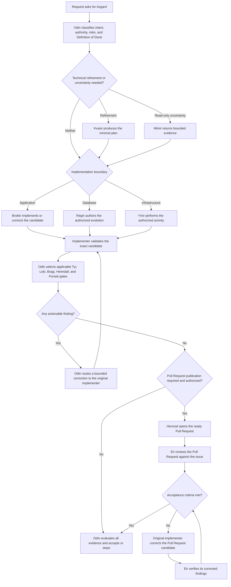

<p align="center">
  
</p>

# Asgard plugin for Codex

Asgard is a Codex plugin for risk-based, multi-agent discovery and software delivery. Odin frames decisions, decomposes substantial work into bounded activities, assigns focused specialists, reviews their evidence, coordinates independent gates, and remains accountable for final acceptance.

The workflow is intentionally proportional: routine changes should stay simple, while complex or high-risk deliveries receive stronger implementation, contract, adversarial, security, governance, and publication controls.

## When to use Asgard

Use Asgard when it is explicitly requested for discovery, delivery, review, infrastructure, deploy, or monitoring, or when work benefits from one or more of the following:

- decision-ready discovery before implementation;
- multiple bounded implementation activities;
- coordinated application and infrastructure work;
- explicit acceptance criteria and dependency ordering;
- independent behavioral, contract, or security review;
- high-assurance deployment promotion with traceable evidence;
- explicit monitoring or monitoring within a governed delivery or release flow.

Do not select it implicitly for routine single-file edits, isolated diagnosis, ordinary maintenance, or standalone release observation that one agent can handle safely. Explicit monitoring remains supported. Asgard should reduce delivery risk, not add ceremony without a concrete reason.

## Role model

`$asgard:asgard` is Odin-only: it plans the execution graph, selects specialists, coordinates their evidence, and owns final acceptance. Complete Odin orchestration requires the Asgard plugin to be installed, because its routing catalog and skills are distributed with that plugin.

Every specialist is a direct entry point. A direct request stays within the named skill's responsibility: it does not invoke a sibling, become delivery orchestration, or take final acceptance. Odin is the only skill that can select and sequence other Asgard skills.

The plugin distributes 13 skills. Invoke every plugin-provided Asgard skill with the `asgard:` namespace. Odin can sequence the skills in a governed delivery, but direct invocation remains independent. Eir, Hermod, and Kvasir can also be installed individually, using their unqualified registered names; these are separate distribution modes and must not be mixed in one task.

### What Odin does

Odin turns a request into a proportional delivery graph. It establishes the intent, authority ceiling, Definition of Done, dependencies, and applicable risk gates; selects only the specialists that the evidence and risk justify; routes findings to the original implementer; and accepts the delivery only after the relevant evidence is complete. Odin does not make a direct skill call another skill, and an approval from Eir, Forseti, or another specialist never replaces Odin's final delivery acceptance.

### Skill summary

| Skill | Invocation | Direct responsibility |
| --- | --- | --- |
| [**Odin**](plugins/asgard/skills/asgard/SKILL.md) | `$asgard:asgard` | Plans the execution graph, coordinates specialists, reviews evidence, and owns final acceptance. |
| [**Kvasir**](plugins/asgard/skills/kvasir/SKILL.md) | `$asgard:kvasir` | Refines one defined issue or delivery demand into a minimal technical plan; it never implements that plan. |
| [**Mimir**](plugins/asgard/skills/mimir/SKILL.md) | `$asgard:mimir` | Resolves one stated technical uncertainty with read-only evidence. |
| [**Brokkr**](plugins/asgard/skills/brokkr/SKILL.md) | `$asgard:brokkr` | Implements one bounded application candidate for an authoritative issue, with task context or a designated Pull Request correction. |
| [**Regin**](plugins/asgard/skills/regin/SKILL.md) | `$asgard:regin` | Owns database architecture and safe schema evolution, including tables, keys, constraints, indexes, relationships, migrations, and data backfills. |
| [**Ymir**](plugins/asgard/skills/ymir/SKILL.md) | `$asgard:ymir` | Discovers, plans, applies authorized infrastructure changes, and verifies the resulting environment. |
| [**Tyr**](plugins/asgard/skills/tyr/SKILL.md) | `$asgard:tyr` | Independently validates material rules, contracts, compatibility, and consistency. |
| [**Loki**](plugins/asgard/skills/loki/SKILL.md) | `$asgard:loki` | Searches adversarially for behavioral gaps and edge cases. |
| [**Bragi**](plugins/asgard/skills/bragi/SKILL.md) | `$asgard:bragi` | Reviews completed code for human readability and maintainability using context-sensitive SOLID, DRY, KISS, YAGNI, and Tell, Don't Ask. |
| [**Heimdall**](plugins/asgard/skills/heimdall/SKILL.md) | `$asgard:heimdall` | Independently reviews security, privacy, isolation, abuse, availability, and risk-justified deep vulnerability analysis. |
| [**Forseti**](plugins/asgard/skills/forseti/SKILL.md) | `$asgard:forseti` | Verifies repository-required delivery and release traceability, including a narrowly authorized metadata repair when policy permits it. |
| [**Hermod**](plugins/asgard/skills/hermod/SKILL.md) | `$asgard:hermod` | Opens an authorized normal or release Pull Request from a ready candidate. |
| [**Eir**](plugins/asgard/skills/eir/SKILL.md) | `$asgard:eir` | Validates a ready Pull Request against its issue and acceptance criteria through review and correction verification. |

Specialists receive task-local context rather than the entire conversation. Their reports and passing tests are evidence; Odin still owns product decisions, inspects the candidate, and makes the acceptance decision. Mimir only resolves stated technical uncertainty read-only. Regin may design and author versioned database changes, but connecting to or mutating any durable, runtime, or non-isolated database, applying or retrying a migration, and executing a rollback each require explicit authority for the exact environment and candidate.

Every direct skill has a direct mode and, when applicable, an Odin-orchestrated mode. In either mode, a skill never invokes Odin or a sibling automatically. If another boundary or authority is necessary, it returns `HANDOFF_REQUIRED` with the recommended skill, reason, evidence, prerequisites, and required authority; the direct requester or Odin decides whether to continue the handoff. Brokkr also records `BRAGI_RECOMMENDED` for each ready candidate; this is a non-blocking recommendation, not an automatic Bragi call.

On first use of each database profile, Regin requests separate read-only discovery authority and consent before persisting a local inventory. Later activities load a compact summary and only relevant object details, refreshing stale, incomplete, affected, or drifted sections instead of rediscovering the whole database. Profiles and inventories live outside the repository and installed plugin under `ASGARD_CONFIG_HOME/databases` when configured, otherwise the platform-local Asgard data directory. They contain no credentials or row data, never replace the runtime database as source of truth, and never authorize `APPLY`; live preflight remains mandatory.

For a database container on a VPS, keep its port private or bound only to VPS loopback and connect through a loopback-only SSH local forward. Ymir owns the verified VPS, tunnel, Docker/network exposure, and external credential mechanisms; Regin separately verifies the database and uses distinct least-privilege principals for application runtime, `DISCOVER`, isolated `VALIDATE`, migration `APPLY`, and emergency administration. Profiles retain only opaque credential references. Tunnel access never authorizes a database phase, and public exposure, identity drift, excess privilege, or tunnel loss fails closed.

Odin applies Asgard once: specialist tasks do not invoke `$asgard:asgard` again. Multi-phase deliveries use compact checkpoints, fresh agent contexts, bounded reports, and a proportional default budget of three simultaneous agents and one grouped correction cycle. Exact paths, revisions, run URLs, and validation conclusions replace copied transcripts, full diffs, and successful logs.

When a user requests vulnerability discovery or Heimdall identifies a need for deeper analysis, Asgard can route a bounded `Security` discipline review. Heimdall uses `$api-security-review` for API surfaces and `$web-security-review` for web application surfaces when those skills are installed. If a relevant skill is missing, Odin asks whether to install it; when installation is declined or unavailable, Heimdall continues with the native security review and records the fallback rather than claiming the specialized skill was applied.

Deep security review is not run for every ordinary delivery. Run it when requested, required by repository policy, or justified by material risk. Confirmed blocking vulnerabilities stop the affected promotion step so corrections can land first.

## Technical refinement

Before a material mutation, Asgard prepares a proportional technical refinement when it improves the delivery decision. It records the intended outcome, affected artifacts or resources, validation, primary risks, exclusions, dependencies, and authority boundary. Lean work remains concise; infrastructure, database, security, release, and operational work additionally records observed state, expected impact, rollback or recovery, and the approval required for each protected operation.

When repository policy or the user requires a persisted plan, Asgard uses the designated artifact and format. It does not assume an issue, GitHub, or a comment structure. A refinement documents a plan and never grants authority to execute it.

For a standalone, implementation-ready refinement of a specific delivery, invoke **Kvasir**. Kvasir inspects the issue and only the necessary code, selects the smallest adequate approach, and records the resulting plan in a new issue comment when the issue and comment authority are explicit. It does not implement the plan or alter Asgard's general refinement policy.

```text
Use $asgard:kvasir to refine issue #123 before implementation.
```

### Kvasir usage rules

- Use Kvasir for an explicit GitHub issue or a defined delivery demand that needs an implementation-ready technical refinement; do not use it to implement, review completed code, or conduct open-ended product discovery.
- It reads repository instructions and only the issue context, code, tests, contracts, configuration, and documentation that can change the recommended plan.
- With an explicitly named, open issue, Kvasir creates exactly one new Markdown comment after the refinement is final. It never edits the issue body, title, labels, or existing comments. A related issue discovered during analysis is not enough to authorize a comment.
- Without an issue, Kvasir returns the refinement in the conversation and does not create a GitHub artifact.
- The result is `READY` only when implementation can begin without a material decision. Otherwise it is `NEEDS_DECISION`, `HANDOFF_REQUIRED`, or `BLOCKED`, with the unresolved choice, required specialist or authority, or smallest next action stated explicitly.
- Kvasir records the analyzed base, evidence, minimal recommended approach, implementation map, acceptance scenarios, validation, exclusions, risks, dependencies, and authority boundaries. Database, infrastructure, security, release, and operational work also include observed state, impact, recovery or rollback, and required approvals.
- A refinement never authorizes branches, implementation, commits, Pull Requests, dependency installation, migrations, data changes, infrastructure changes, deployment, or publication.

## Intent catalog

Asgard recognizes natural-language requests as `DISCOVERY`, `DELIVERY`, `REVIEW`, `INFRASTRUCTURE`, `DEPLOY`, or `MONITOR`. It infers a clear intent and asks only when ambiguity would materially change the result, scope, environment, or authority.

Intent never grants authority. Discovery produces a concise, decision-ready brief and stops for approval; it does not create issues or implement. After approval, Asgard may prepare or create issues only when authorized, then enter delivery. Application promotion follows the repository's authorized workflow through Hermod when a Pull Request must be opened, while infrastructure work belongs to Ymir.

Natural examples:

- “Use Asgard para explorar esta ideia.”
- “Use Asgard para desenvolver esta funcionalidade.”
- “Faça o discovery e pare antes de criar as issues.”
- “Faça o discovery e, se eu aprovar, prepare as issues.”
- “Revise este PR quanto a comportamento e segurança.”
- “Planeje esta mudança de infraestrutura, mas não aplique.”
- “Faça deploy da revisão aprovada em staging.”
- “Monitore o CI do PR 42.”

## Delivery modes

- **Lean:** one bounded, low-risk activity with an implementer and Odin review. Add a specialist gate only for an identified risk; Odin or the direct requester considers Brokkr's Bragi recommendation when maintainability is a stated concern.
- **Standard:** multiple activities or material behavioral risk, with independent Loki and Heimdall review, Tyr when contracts or rules are affected, and a recorded Odin or direct-requester decision on Brokkr's Bragi recommendation when production code is added or structurally changed.
- **Critical:** security-sensitive, persistent, concurrent, irreversible, regulated, or broadly exposed work, using every applicable independent gate. Odin considers Brokkr's Bragi recommendation proportionate to the candidate's maintenance risk.

## Odin orchestration flow

Odin selects only the paths that apply to the request. Kvasir, Mimir, individual reviewers, Pull Request publication, and acceptance validation are conditional; they are not automatic work added to every delivery.



In a Pull Request correction cycle, Eir verifies its own findings after the original implementer returns a corrected candidate. Odin repeats only the affected validations, then remains the final acceptance authority. Brokkr emits a non-blocking Bragi recommendation for each ready application candidate; Odin or the direct requester decides whether to request Bragi.

Asgard classifies dependencies as sequential, parallel-safe, parallel-with-coordination, or deferred. It does not parallelize work merely to fill agent slots, and it avoids repeating complete reviews when integration creates no new diff or invariant.

CI monitoring remains a bounded operational activity. The watcher stays silent while CI is pending; unchanged CI never summons reviewers or restarts the orchestration graph.

At discussion-to-implementation and implementation-to-review boundaries, Odin replaces accumulated narrative with a compact phase checkpoint containing only the candidate, decisions, changed artifacts, validation, approvals, deviations, open risks, next activity, and remaining authority. When usage is available, final reporting aggregates incremental tokens by role and phase without spending extra turns to reconstruct missing telemetry.

## Definitions of Done and authority

Every activity receives an observable objective, proportionate refinement when useful or policy-required, bounded artifact ownership, dependencies, primary failure mode, focused validation, rejection conditions, and applicable reviewers. Tests normally run once after the implementer has inspected the final diff.

Approval never grants authority to commit, push, open or merge pull requests, publish releases, deploy, migrate data, mutate infrastructure, add dependencies, or perform destructive operations. Repository instructions and explicit user authority remain controlling.

For GitHub, Asgard uses the repository's authorized tooling. It does not silently fall back to an unapproved client when authentication, authorization, scopes, or commands fail. Browser operation is reserved for a documented capability gap and requires an explanation plus explicit user authorization for that exceptional operation.

## Delivery governance

When the repository requires traceability, Forseti checks the policy-required evidence available at each lifecycle phase. That can include issues, branches, pull requests, closing relationships, labels, changelogs, release notes, or checks, but Asgard does not define the taxonomy or make any of them universal.

When policy requires a provider-recognized closing reference, Forseti may repair one absent, unambiguous reference only with authority for that exact edit. Missing evidence that cannot exist yet is `PENDING`; a violated repository invariant is `CHANGES_REQUIRED`. Forseti's approval covers governance only.

## Prerequisites and conditional capabilities

To use the plugin, you need a Codex environment with plugin support and the `codex plugin` command available. Start a new Codex task after installing or updating the plugin so its skills are loaded. No Python, Node.js, database client, cloud CLI, or GitHub account is required for ordinary local planning, implementation, or review work.

The source-installation method below additionally requires Git. Git is not a runtime dependency after the plugin is installed.

### GitHub activities

GitHub access is conditional: it is required only when the selected skill must read or change GitHub artifacts. For example, Kvasir comments on an explicitly supplied issue, Hermod opens a Pull Request, and Eir reviews a Pull Request. In those cases, the environment needs:

- the repository-approved GitHub tooling; when it is `gh`, the GitHub CLI must be installed and authenticated for the intended account and host;
- access and scopes appropriate to the exact repository operation; and
- explicit authority for any mutation, such as commenting, opening a Pull Request, approving, or resolving an Eir-owned thread.

If the required GitHub capability, authentication, scope, or authority is unavailable, the selected skill reports the bounded blocker or `HANDOFF_REQUIRED`; it does not silently switch clients or broaden its authority.

### Repository development only

Python, PyYAML, and the repository test tooling are needed only to develop or validate this plugin repository. They are not requirements for people or agents running an installed Asgard plugin.

## Install the plugin

The `master` branch contains the latest stable release:

```bash
git clone --branch master https://github.com/VissotoFlavio/asgard-codex-skill.git
cd asgard-codex-skill
codex plugin marketplace add .
codex plugin add asgard@asgard-community
```

Start a new Codex task after installation so the plugin and its skill are loaded.

Invoke Asgard explicitly:

```text
Use $asgard:asgard to plan and coordinate this software delivery.
```

Codex may also select Asgard automatically when a request clearly matches its scope.

## Invoke a skill directly

With the plugin installed, invoke a skill directly when the request is already bounded to that responsibility: `$asgard:brokkr`, `$asgard:regin`, `$asgard:ymir`, `$asgard:mimir`, `$asgard:tyr`, `$asgard:loki`, `$asgard:bragi`, `$asgard:heimdall`, `$asgard:forseti`, `$asgard:hermod`, `$asgard:eir`, or `$asgard:kvasir`.

```text
Use $asgard:brokkr to implement this small bounded change with the established architecture.
```

```text
Use $asgard:heimdall to review this exact candidate for security and privacy risks.
```

Direct invocation does not start Odin orchestration. A skill can recommend another skill only by returning `HANDOFF_REQUIRED`; it never calls Odin or a sibling automatically. Brokkr's `BRAGI_RECOMMENDED` is likewise only a recommendation. Use `$asgard:asgard` when the work needs Odin to plan, select, and coordinate multiple bounded activities or independent review gates.

## Update the plugin

Update the stable checkout and reinstall the marketplace entry:

```bash
cd asgard-codex-skill
git switch master
git pull --ff-only origin master
codex plugin add asgard@asgard-community
```

Open a new Codex task after reinstalling.

## Use Hermod through the plugin

Hermod is a direct workflow skill distributed by the plugin. Use it when a ready candidate needs an authorized normal Pull Request or release Pull Request, without invoking Odin:

```text
Use $asgard:hermod to open the Pull Request for this ready branch and issue.
```

For a normal Pull Request, Hermod checks the ready candidate, authoritative issue, target branch, validation evidence, and publication authority, then opens it. For a release Pull Request, it additionally selects the next Semantic Version, updates the changelog, and targets `develop` to `master`. Hermod does not implement or validate issue acceptance. Merge, tag, publication, deploy, and infrastructure changes require separate authorization.

## Use Eir through the plugin

Eir validates a ready Pull Request against its authoritative issue, initial context, acceptance criteria, and exact candidate revision. `REVIEW` publishes one evidence-backed COMMENT review. If Brokkr corrects an Eir finding, `VERIFY` checks that correction. Eir can resolve only its own threads and approve only when exact authority is supplied; it never implements, opens Pull Requests, merges, deploys, or makes final delivery acceptance.

```text
Use $asgard:eir to review this Pull Request and publish the findings.
```

## Install an independent workflow

Install the plugin when you need Odin or any of its 12 direct skills; all of those invocations use `$asgard:<skill>`. Eir, Hermod, and Kvasir can instead be installed individually when the task needs only that workflow. After a standalone installation, invoke the registered skill as `$eir`, `$hermod`, or `$kvasir`; do not use the `asgard:` namespace for that installation.

Use one of these direct skill sources with the Codex skill-installation flow:

```text
https://github.com/VissotoFlavio/asgard-codex-skill/tree/master/plugins/asgard/skills/eir
https://github.com/VissotoFlavio/asgard-codex-skill/tree/master/plugins/asgard/skills/hermod
https://github.com/VissotoFlavio/asgard-codex-skill/tree/master/plugins/asgard/skills/kvasir
```

## Repository and release workflow

- `develop` contains the next candidate changes.
- Every delivery branch follows `{prefix}/{issue-id}-{name}`, where `name` is a short lowercase kebab-case slug and the ID belongs to its authoritative issue. Release branches use `release/<version>` and do not require an issue.
- `feature/<issue-id>-<name>`, `fix/<issue-id>-<name>`, `docs/<issue-id>-<name>`, and related delivery branches originate from and return to `develop`.
- `release/<version>` originates from `develop` and targets `master`.
- `hotfix/<issue-id>-<version>` originates from and targets `master`.
- `master` contains stable, versioned releases.
- Squash is reserved for delivery pull requests created from `develop` and targeting `develop`; release and backport pull requests always use merge commits.
- [CHANGELOG.md](./CHANGELOG.md) is updated for every delivery PR and records each release version; delivery entries include issue and pull-request links.
- [GitHub Releases](https://github.com/VissotoFlavio/asgard-codex-skill/releases) contains stable release notes.

After an approved release merge reaches `master`, the repository workflow validates the version, creates the immutable tag and GitHub Release, and opens a `master` to `develop` backport pull request. The release creates no issue; the backport creates no additional branch or issue. Before completion, the final release description must explicitly list every delivery issue and pull request included in production. Production publication failures leave the tag in place and require a new corrective version.

## Prepare a version

Maintainers can update the authoritative plugin version without creating a commit, tag, or release automatically:

```bash
python scripts/bump_version.py patch
python scripts/bump_version.py minor
python scripts/bump_version.py major
python scripts/bump_version.py 1.2.3
python scripts/bump_version.py patch --dry-run
```

The release workflow creates the tag and GitHub Release only after the version change is approved and merged through the normal release pull request.

## Portability

Asgard adapts to the available agent capacity, version-control system, isolation mechanism, repository policy, and publication workflow. GitHub-specific mechanics are used only when the repository and authorized tooling support them.

## License

[MIT](./LICENSE)
